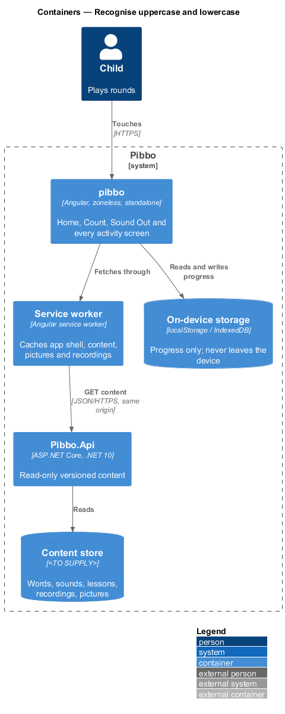
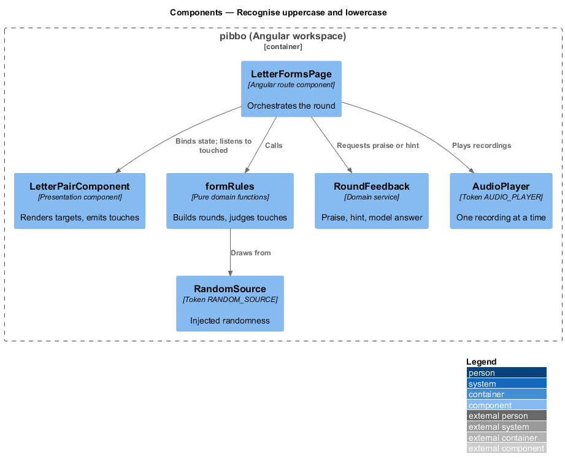
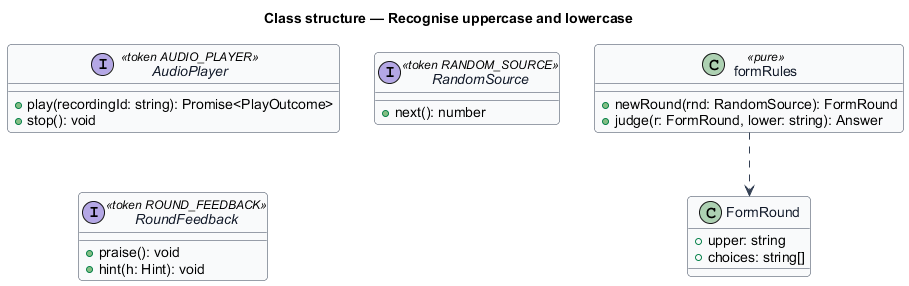

# Recognise uppercase and lowercase

## Overview

An uppercase letter is shown with three lowercase choices; the child touches the matching lowercase form. Letters use the house letterforms: single-storey a and g, and b, d, p, q and I, l, 1 clearly distinct.

## Description

The feature is a vertical slice through the Angular workspace: the page in the `pibbo` application, presentation components in `@pibbo/components`, pure rules in `@pibbo/domain`, and the contracts and tokens in `@pibbo/api`.

- **`LetterFormsPage`** — route component in `pibbo`, loaded by `loadComponent` when the child chooses the activity. It is provided with its own `formRules` state at route scope, asks the rules for each round, plays recordings through `AUDIO_PLAYER` and hands state to the presentation component.
- **`LetterPairComponent`** — presentation component in `@pibbo/components` (selector `pb-letterpair`). It takes the round state as signal inputs, emits a `touched` output per target, and injects no service.
- **`FormRound`** — immutable round state in `@pibbo/domain/sounds`; every transition returns a new value.
- **`formRules`** — pure functions in `@pibbo/domain/sounds` that build a round from the injected `RandomSource` and decide the outcome of each touch, with unit tests.
- **`AudioPlayer`** — contract in `@pibbo/api` bound to `AUDIO_PLAYER`. Playing a recording stops the one before it; a recording that cannot play resolves as `unavailable` and the screen shows the text instead.
- **`RoundFeedback`** — shared round behaviour (`retry-and-praise`): brief praise, hints after a wrong answer, and modelling the answer after three wrong answers.
- **`House letterforms`** — the bundled self-hosted font chosen by the design system; the font itself is `<TO SUPPLY>` until the mocks and design system exist.

## Requirements

The feature realises the following level-2 (L2) requirements. Each L2 requirement refines a level-1 (L1) requirement, cited by identifier.

| L2 ID | Refines (L1) | Requirement |
|-------|--------------|-------------|
| `L2-011` | `L1-009` | Recognise uppercase and lowercase |

Acceptance criteria of `L2-011` (Recognise uppercase and lowercase):

1. Given uppercase B with lowercase choices b, d, p, when the child touches b, then B and b are joined and praise plays.
2. Given the same round, when the child touches d, then d's sound plays, B and b are shown side by side as a hint, and the child chooses again.
3. Given any round, when rendered, then letters use the house letterforms: single-storey a and g, and b/d/p/q and I/l/1 clearly distinct.

## Diagrams

### System context

The child uses Pibbo directly; a grown-up is beside or nearby and is not needed to make the feature work. No third-party system takes part.

### Containers

The feature runs in the `pibbo` single-page application. Content arrives from `Pibbo.Api` through the service worker cache; nothing a child does is sent back.

### Components

`LetterFormsPage` composes `LetterPairComponent` for presentation and calls `formRules` for every decision. The page is the only part that injects tokens; the rules hold no Angular dependency.

### Class structure

`FormRound` is the value the rules transform; `LetterFormsPage` holds it in a signal and passes it to `LetterPairComponent`.

### Match the lowercase form

A right choice joins the pair; a wrong choice plays that letter's sound and shows the right pair side by side.

