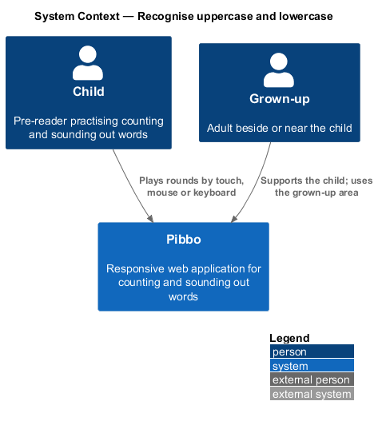
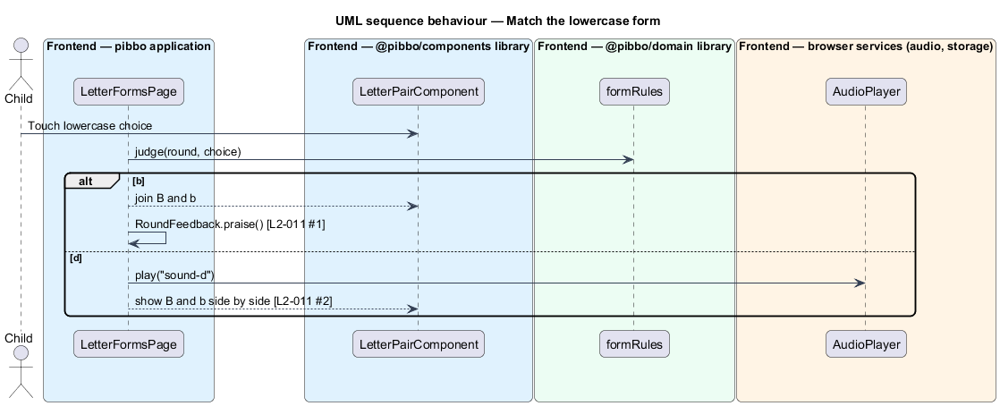

# Recognise uppercase and lowercase

## Overview

Four big letters are shown in one column and their four small letters in another, in a different order; the child touches a big letter, then its small letter. Letters use the house letterforms (Andika): single-storey a and g, and b, d, p, q and I, l, 1 clearly distinct. ADR 0017 records how this design was brought in line with the mocks.

## Description

The feature is a vertical slice through the Angular workspace: the page in the `pibbo` application, presentation components in `@pibbo/components`, pure rules in `@pibbo/domain`, and the contracts and tokens in `@pibbo/api`.

- **`BigAndSmallLetters`** — route component in `pibbo` (`/read/letter-forms`), loaded by `loadComponent` when the child chooses the activity. It holds the round in a signal, asks the rules for every touch, plays recordings through `AUDIO_PLAYER`, times praise and the shake with `CLOCK`, and provides its own `ASSET_PRELOADER` so its fetches end when the child leaves.
- **`Pairs`** — presentation component in `@pibbo/components` (selector `pb-pairs`), shared with Letter sounds. With `kind="forms"` it draws the Big and Small heads and a small letter in the second column. It takes signal inputs, emits `letter` and `sound` outputs and injects no service.
- **`LetterSoundsRound<FormPair>`** — the immutable pair-match state of Letter sounds (`matching`, `right`), generic over `MatchPair`; every transition returns a new value.
- **`startLetterFormsRound`, `holdLetter`, `matchSound`, `pairColour`, `letterFormsAssets`** — pure functions in `@pibbo/domain/sounds`: the small letters are ordered by the injected `RandomSource`, never in the big letters' order; a touch holds or matches. Unit-tested.
- **`LETTER_FORMS`** — the content (pairs, instruction, praise, rounds a play) in `sound-out-content.json`, checked before every build by `tools/content/check-content.mjs`.
- **`AudioPlayer`** — contract in `@pibbo/api` bound to `AUDIO_PLAYER`. Playing a recording stops the one before it; a recording that cannot play never blocks the round, because every sound is shown as its letter.
- **House letterforms** — Andika, bundled and self-hosted (ADR 0003), read as `--font-read`.

## Requirements

The feature realises the following level-2 (L2) requirements. Each L2 requirement refines a level-1 (L1) requirement, cited by identifier.

| L2 ID | Refines (L1) | Requirement |
|-------|--------------|-------------|
| `L2-011` | `L1-009` | Recognise uppercase and lowercase |

Acceptance criteria of `L2-011` (Recognise uppercase and lowercase):

1. Given the big letters A, B, D, G and the small letters a, b, d, g, when the child touches B and then b, then b's sound is spoken, and B and b are joined in the same colour, marked as matched and no longer take a touch; when all four are matched, then brief praise is spoken and shown and Next is offered.
2. Given any letter, big or small, when touched, then its sound ("b") is spoken, never its name ("bee"); a touched big letter is held.
3. Given D is held, when the child touches b, then b's sound is spoken, b gives a small shake (none with reduced motion), D stays held, and nothing is taken away; there is no timer and no limit on tries.
4. Given any round, when rendered, then letters use the house letterforms (Andika): single-storey a and g, and b/d/p/q and I/l/1 clearly distinct.

## Diagrams

The diagrams predate ADR 0017 and still draw the earlier names (`LetterFormsPage`, `LetterPairComponent`, `FormRound`, `formRules`) and a content API; read them as `BigAndSmallLetters`, `Pairs`, `LetterSoundsRound<FormPair>` and the pair-match rules, with content bundled in the app.

### System context

The child uses Pibbo directly; a grown-up is beside or nearby and is not needed to make the feature work. No third-party system takes part.

### Containers

The feature runs in the `pibbo` single-page application. Content is bundled with the app; nothing a child does is sent anywhere.

### Components

`BigAndSmallLetters` composes `Pairs` for presentation and calls the pair-match rules for every decision. The page is the only part that injects tokens; the rules hold no Angular dependency.

### Class structure

`LetterSoundsRound<FormPair>` is the value the rules transform; `BigAndSmallLetters` holds it in a signal and passes it to `Pairs`.

### Match the small letter

A right choice joins the pair; a wrong choice speaks that letter's sound and shakes it, and the big letter stays held.

