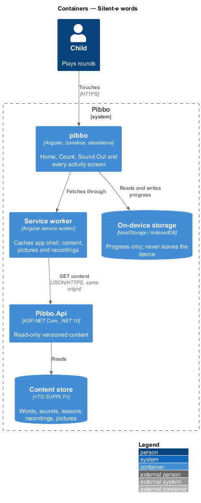
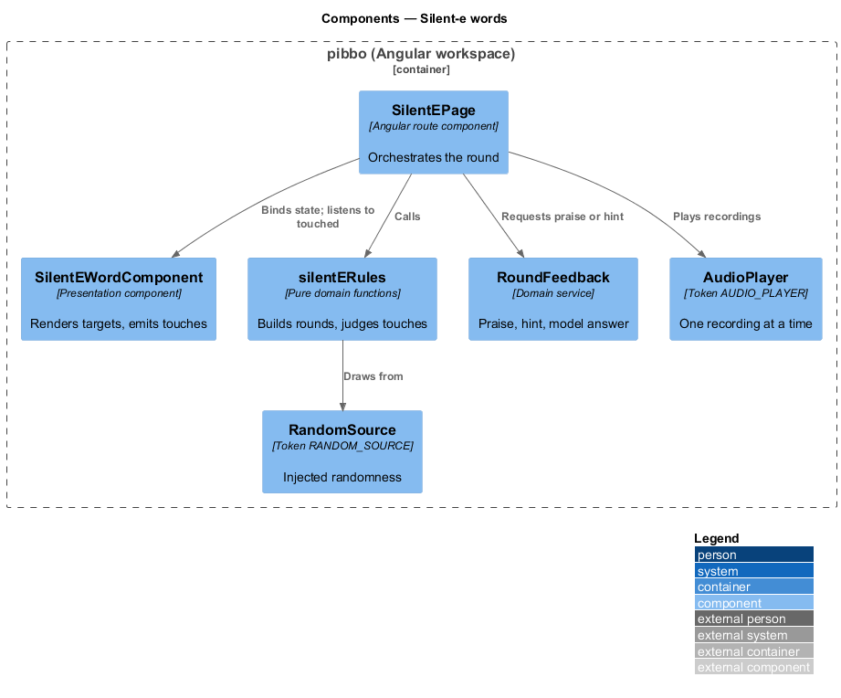
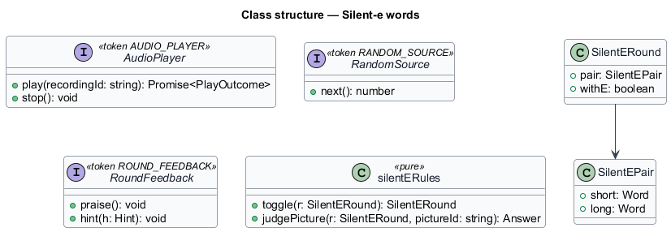
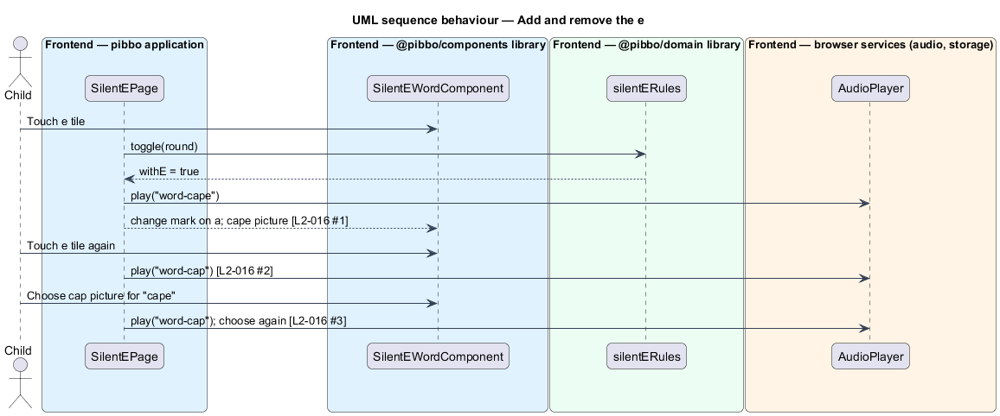

# Silent-e words

## Overview

A final e changes a word and its vowel: "cap" becomes "cape". The child toggles an e tile and sees and hears the change, then picks the picture for a spoken word.

## Description

The feature is a vertical slice through the Angular workspace: the page in the `pibbo` application, presentation components in `@pibbo/components`, pure rules in `@pibbo/domain`, and the contracts and tokens in `@pibbo/api`.

- **`SilentEPage`** — route component in `pibbo`, loaded by `loadComponent` when the child chooses the activity. It is provided with its own `silentERules` state at route scope, asks the rules for each round, plays recordings through `AUDIO_PLAYER` and hands state to the presentation component.
- **`SilentEWordComponent`** — presentation component in `@pibbo/components` (selector `pb-silenteword`). It takes the round state as signal inputs, emits a `touched` output per target, and injects no service.
- **`SilentERound`** — immutable round state in `@pibbo/domain/sounds`; every transition returns a new value.
- **`silentERules`** — pure functions in `@pibbo/domain/sounds` that build a round from the injected `RandomSource` and decide the outcome of each touch, with unit tests.
- **`AudioPlayer`** — contract in `@pibbo/api` bound to `AUDIO_PLAYER`. Playing a recording stops the one before it; a recording that cannot play resolves as `unavailable` and the screen shows the text instead.
- **`RoundFeedback`** — shared round behaviour (`retry-and-praise`): brief praise, hints after a wrong answer, and modelling the answer after three wrong answers.

## Requirements

The feature realises the following level-2 (L2) requirements. Each L2 requirement refines a level-1 (L1) requirement, cited by identifier.

| L2 ID | Refines (L1) | Requirement |
|-------|--------------|-------------|
| `L2-016` | `L1-014` | Silent-e words |

Acceptance criteria of `L2-016` (Silent-e words):

1. Given "cap" with its picture, when the child touches the e tile, then the word becomes "cape", the a tile shows a change mark, "cape" is spoken, and the picture changes to a cape.
2. Given "cape", when the child touches the e tile again, then e is removed and "cap" is spoken.
3. Given a round asking for the picture of "cape", when the cap picture is chosen, then "cap" is spoken and the child chooses again.

## Diagrams

### System context

The child uses Pibbo directly; a grown-up is beside or nearby and is not needed to make the feature work. No third-party system takes part.

### Containers

The feature runs in the `pibbo` single-page application. Content arrives from `Pibbo.Api` through the service worker cache; nothing a child does is sent back.

### Components

`SilentEPage` composes `SilentEWordComponent` for presentation and calls `silentERules` for every decision. The page is the only part that injects tokens; the rules hold no Angular dependency.

### Class structure

`SilentERound` is the value the rules transform; `SilentEPage` holds it in a signal and passes it to `SilentEWordComponent`.

### Add and remove the e

Toggling e swaps word, picture and recording and marks the changed vowel.

