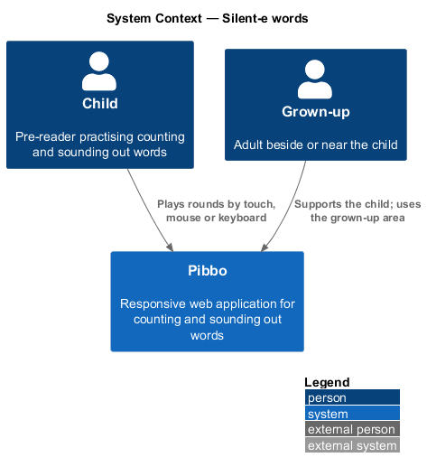

# Silent-e words

## Overview

A final e changes a word and its vowel: "cap" becomes "cape". The child toggles an e tile and sees and hears the change, then picks the picture for a spoken word.

## Description

The feature is a vertical slice through the Angular workspace: the page in the `pibbo` application, presentation components in `@pibbo/components`, pure rules in `@pibbo/domain`, and the contracts and tokens in `@pibbo/api`.

As built (ADR 0021), the feature lives inside Sound it out rather than in a page of its own:

- **`SoundItOut`** — the Sound it out route component in `pibbo`, loaded by `loadComponent`. For a silent-e word it first asks for the quiet e, speaks the word made each time the e is added or taken away through `AUDIO_PLAYER`, and then runs the round as for any word.
- **`WordTiles`** — presentation component in `@pibbo/components` (selector `pb-word-tiles`). Its `quietE` input draws the e as a toggle tile after the letters (`tile--silent`, `tile--added`, `aria-pressed`), its `changed` input marks the vowel the e changes (`tile--changed`, `tile__mark`), and its `toggledE` output reports a touch on the e.
- **`SilentE`** — presentation component in `@pibbo/components` (selector `pb-silent-e`): the rule around its vowel (`.rule`) and the word shown now with its picture and a note (`.before`). While the child picks the picture only the rule is shown.
- **`SoundOutRound`** — immutable round state in `@pibbo/domain/sounds`, with a `magic-e` phase before sounding and `eAdded` for a silent-e word. A silent-e `Word` carries the word it is without its e (`withoutE`).
- **`toggleSilentE`, `changedLetter`, `shownSounds`** — pure functions in `@pibbo/domain/sounds`: the first adds or takes away the e and names the word to speak; the second finds the letter the e changes; the third gives the sounds to show. A silent-e round offers the picture of the word without its e among its three. Unit tested.
- **`AudioPlayer`** — contract in `@pibbo/api` bound to `AUDIO_PLAYER`. Playing a recording stops the one before it; a recording that cannot play resolves as `unavailable` and the screen shows the text instead.
- **`RoundFeedback`** — shared round behaviour (`retry-and-praise`): brief praise, hints after a wrong answer, and modelling the answer after three wrong answers.

## Requirements

The feature realises the following level-2 (L2) requirements. Each L2 requirement refines a level-1 (L1) requirement, cited by identifier.

| L2 ID | Refines (L1) | Requirement |
|-------|--------------|-------------|
| `L2-016` | `L1-014` | Silent-e words |

Acceptance criteria of `L2-016` (Silent-e words):

1. Given "cap" with its picture, when the child touches the e tile, then the word becomes "cape", the a tile shows a change mark, "cape" is spoken, and the picture changes to a cape.
2. Given "cape", when the child touches the e tile again, then e is removed and "cap" is spoken.
3. Given a round asking for the picture of "cape", when the cap picture is chosen, then "cap" is spoken and the child chooses again.

## Diagrams

### System context

The child uses Pibbo directly; a grown-up is beside or nearby and is not needed to make the feature work. No third-party system takes part.

### Containers

The feature runs in the `pibbo` single-page application. Content arrives from `Pibbo.Api` through the service worker cache; nothing a child does is sent back.

### Components

`SilentEPage` composes `SilentEWordComponent` for presentation and calls `silentERules` for every decision. The page is the only part that injects tokens; the rules hold no Angular dependency.

### Class structure

`SilentERound` is the value the rules transform; `SilentEPage` holds it in a signal and passes it to `SilentEWordComponent`.

### Add and remove the e

Toggling e swaps word, picture and recording and marks the changed vowel.

