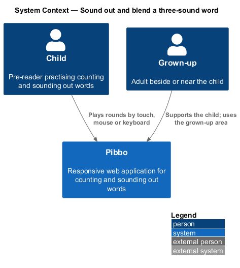
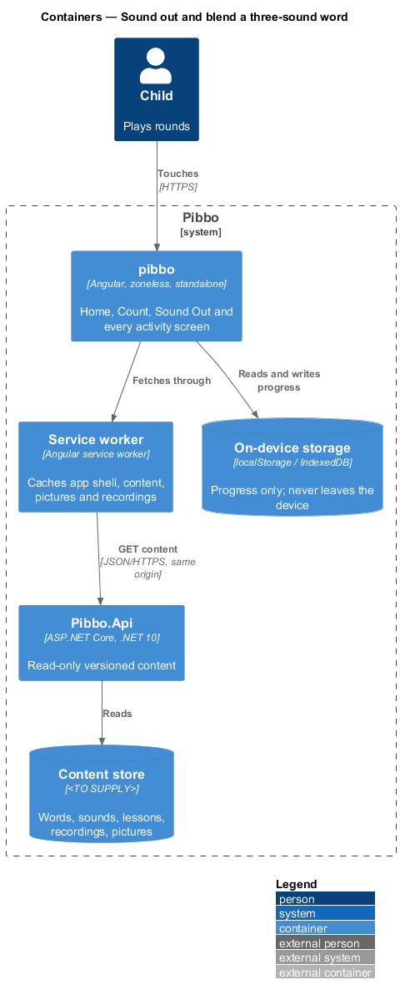
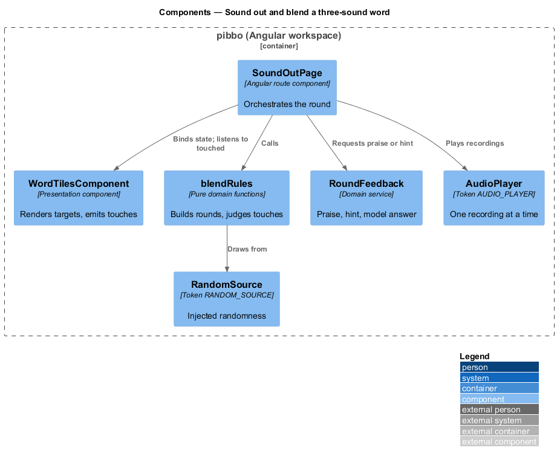
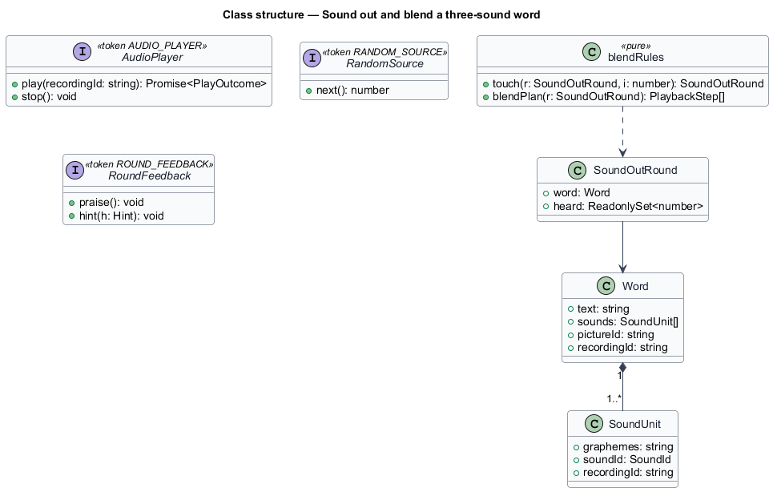
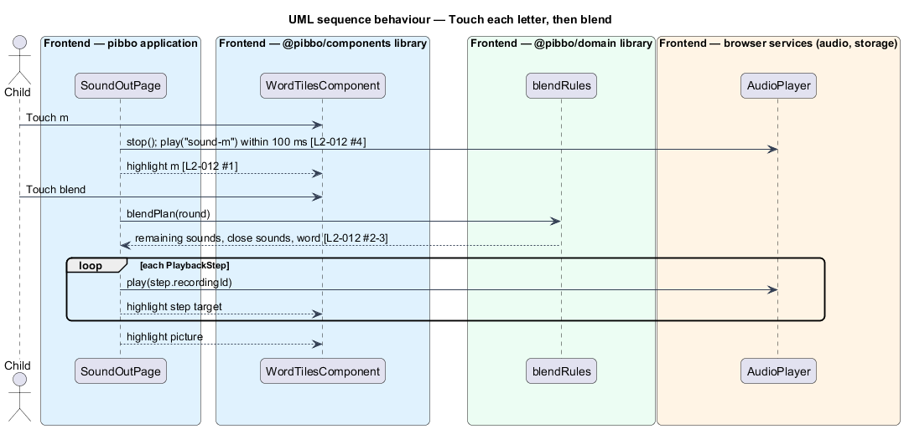

# Sound out and blend a three-sound word

## Overview

Sound Out is the reading activity. A short word of three single-letter sounds ("map") appears with its picture. The child touches each letter to hear its sound, then touches *blend* to hear the sounds run together into the word.

- **blending** — speaking a word's sounds closer together until they become the word
- **blend control** — touch target that starts blending

## Description

The feature is a vertical slice through the Angular workspace: the page in the `pibbo` application, presentation components in `@pibbo/components`, pure rules in `@pibbo/domain`, and the contracts and tokens in `@pibbo/api`.

- **`SoundOutPage`** — route component in `pibbo`, loaded by `loadComponent` when the child chooses the activity. It is provided with its own `blendRules` state at route scope, asks the rules for each round, plays recordings through `AUDIO_PLAYER` and hands state to the presentation component.
- **`WordTilesComponent`** — presentation component in `@pibbo/components` (selector `pb-wordtiles`). It takes the round state as signal inputs, emits a `touched` output per target, and injects no service.
- **`SoundOutRound`** — immutable round state in `@pibbo/domain/sounds`; every transition returns a new value.
- **`blendRules`** — pure functions in `@pibbo/domain/sounds` that build a round from the injected `RandomSource` and decide the outcome of each touch, with unit tests.
- **`AudioPlayer`** — contract in `@pibbo/api` bound to `AUDIO_PLAYER`. Playing a recording stops the one before it; a recording that cannot play resolves as `unavailable` and the screen shows the text instead.
- **`RoundFeedback`** — shared round behaviour (`retry-and-praise`): brief praise, hints after a wrong answer, and modelling the answer after three wrong answers.
- **`PlaybackStep`** — one recording plus the tile or picture to highlight while it plays; a blend plan is a list of steps played in order through `AUDIO_PLAYER`.

## Requirements

The feature realises the following level-2 (L2) requirements. Each L2 requirement refines a level-1 (L1) requirement, cited by identifier.

| L2 ID | Refines (L1) | Requirement |
|-------|--------------|-------------|
| `L2-012` | `L1-010` | Sound out and blend a three-sound word. A word of three single-letter sounds ("map") is shown with its picture. |

Acceptance criteria of `L2-012` (Sound out and blend a three-sound word):

1. Given "map" is shown, when the child touches m, a, p in turn, then "mmm", "a", "p" are spoken and each letter is highlighted as it sounds.
2. Given all three sounds have been heard, when the child touches blend, then the sounds are spoken closer together, "map" is spoken, and the picture is highlighted.
3. Given not every letter has been touched, when the child touches blend, then the remaining sounds are spoken first and then the word is blended.
4. Given a recording is playing, when another letter is touched, then the playing recording stops and the new one starts within 100 ms.

## Diagrams

### System context

The child uses Pibbo directly; a grown-up is beside or nearby and is not needed to make the feature work. No third-party system takes part.

### Containers

The feature runs in the `pibbo` single-page application. Content arrives from `Pibbo.Api` through the service worker cache; nothing a child does is sent back.

### Components

`SoundOutPage` composes `WordTilesComponent` for presentation and calls `blendRules` for every decision. The page is the only part that injects tokens; the rules hold no Angular dependency.

### Class structure

`SoundOutRound` is the value the rules transform; `SoundOutPage` holds it in a signal and passes it to `WordTilesComponent`.

### Touch each letter, then blend

Each touch stops the playing recording and starts the new one within 100 ms. Blend first plays any sound not yet heard, then the sounds closer together, then the word.

