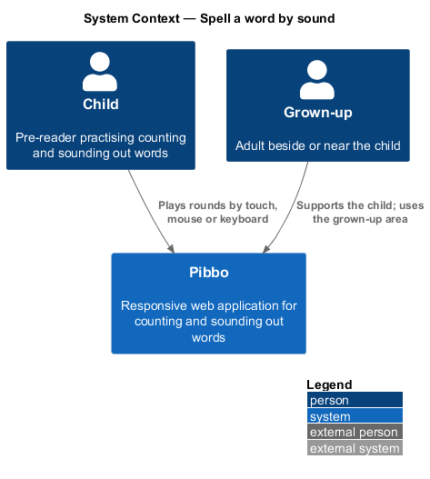
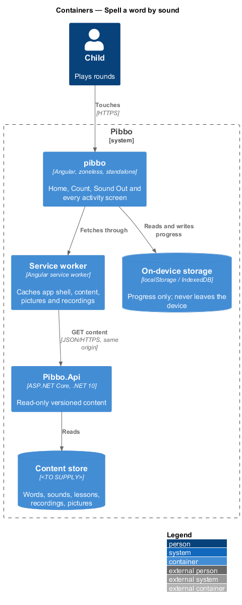
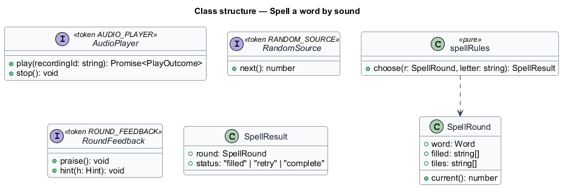
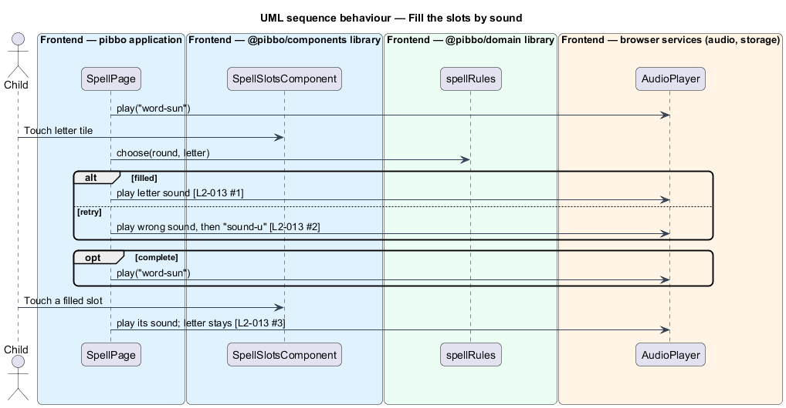

# Spell a word by sound

## Overview

A word is spoken and shown with its picture and one empty *box* for each sound. The child touches letters from a *bank* of up to 6; each says its sound and fills the next box. When every box is filled, the child checks the word (ADR 0018).

- **box** — place in the word that holds one chosen letter; the next box is the first empty one
- **bank** — the letters to choose from: the word's letters and others, in an order the random source chooses

## Description

The feature is a vertical slice through the Angular workspace: the page in the `pibbo` application, presentation components in `@pibbo/components`, pure rules in `@pibbo/domain`, and the contracts and tokens in `@pibbo/api`.

- **`SpellBySound`** — route component in `pibbo` (`/read/spell`), loaded by `loadComponent` when the child chooses the activity. It holds the round in a signal, provides `ASSET_PRELOADER` at route scope, plays recordings through `AUDIO_PLAYER` and hands state to the presentation component.
- **`SpellBoxes`** — presentation component in `@pibbo/components` (selector `pb-spell-boxes`). It takes the word's sounds, the boxes, the bank and the phase as signal inputs, emits `letter`, `box` and `speaker` outputs, and injects no service.
- **`SpellRound`** — immutable round state in `@pibbo/domain/sounds` (`spelling`, `full`, `retry`, `right`); every transition returns a new value.
- **Spell rules** — pure functions in `@pibbo/domain/sounds`: `startSpellRound` (from the injected `RandomSource`), `placeLetter`, `removeLetter`, `checkSpelling`, `trySpellingAgain` and `spellAssets`, with unit tests.
- **`AudioPlayer`** — contract in `@pibbo/api` bound to `AUDIO_PLAYER`. Playing a recording stops the one before it; a recording that cannot play never blocks the round, because everything spoken is shown.
- **Content** — Sound it out's words (ADR 0008) and the `spell` block of `sound-out-content.json`: its instructions, hint and praise, checked before every build.

## Requirements

The feature realises the following level-2 (L2) requirements. Each L2 requirement refines a level-1 (L1) requirement, cited by identifier.

| L2 ID | Refines (L1) | Requirement |
|-------|--------------|-------------|
| `L2-013` | `L1-011` | Spell a word by sound |

Acceptance criteria of `L2-013` (Spell a word by sound):

1. Given "sun" is spoken and shown with its picture, three empty boxes and up to 6 letters, when the child touches a letter, then its sound is spoken and it fills the next empty box, which is marked.
2. Given a filled box, when the child touches it, then its letter is taken out and that box is the next to fill.
3. Given a box's speaker or an empty box, when touched, then the sound that belongs in that box is spoken.
4. Given every box is filled, then the letters take no touch, "Does it say the word? Check it!" is spoken and shown, and Check is ready.
5. Given s, u, n in the boxes, when the child checks, then each sound and then "You spelled" and "sun" are spoken, the boxes show right, and "s – u – n. You spelled “sun”!" is shown with Next.
6. Given s, u, m in the boxes, when the child checks, then "Say it slowly. Which sound doesn’t match?" is spoken and shown with Try again; Try again takes out only the letters that do not match, and nothing else is lost.

## Open questions

- Whether the word is modelled after the third wrong check (`L2-026` #2): no mock draws it (ADR 0018).
- Which words Spell by sound asks, and in what order; the real recordings.

## Diagrams

### System context

The child uses Pibbo directly; a grown-up is beside or nearby and is not needed to make the feature work. No third-party system takes part.

### Containers

The feature runs in the `pibbo` single-page application. Content is bundled with the app; there is no backend, and nothing a child does leaves the device.

### Components

`SpellBySound` composes `SpellBoxes` for presentation and calls the spell rules for every decision. The page is the only part that injects tokens; the rules hold no Angular dependency.

### Class structure

`SpellRound` is the value the rules transform; `SpellBySound` holds it in a signal and passes it to `SpellBoxes`.

### Fill the boxes by sound

A touched letter says its sound and fills the next box; Check speaks each sound and the word when right, or a hint and Try again, which keeps the right letters. The diagrams predate ADR 0018 and show the earlier slot rule; the text here is current.

