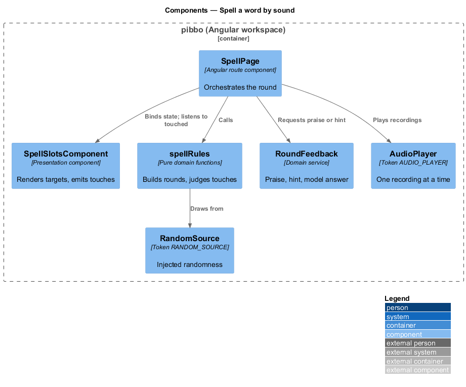

# Spell a word by sound

## Overview

A word is spoken with its picture and three empty *slots*. The child chooses, from up to 6 letter tiles, the letter for each sound in order.

- **slot** — place in the word that holds one chosen letter; the current slot is the next to fill

## Description

The feature is a vertical slice through the Angular workspace: the page in the `pibbo` application, presentation components in `@pibbo/components`, pure rules in `@pibbo/domain`, and the contracts and tokens in `@pibbo/api`.

- **`SpellPage`** — route component in `pibbo`, loaded by `loadComponent` when the child chooses the activity. It is provided with its own `spellRules` state at route scope, asks the rules for each round, plays recordings through `AUDIO_PLAYER` and hands state to the presentation component.
- **`SpellSlotsComponent`** — presentation component in `@pibbo/components` (selector `pb-spellslots`). It takes the round state as signal inputs, emits a `touched` output per target, and injects no service.
- **`SpellRound`** — immutable round state in `@pibbo/domain/sounds`; every transition returns a new value.
- **`spellRules`** — pure functions in `@pibbo/domain/sounds` that build a round from the injected `RandomSource` and decide the outcome of each touch, with unit tests.
- **`AudioPlayer`** — contract in `@pibbo/api` bound to `AUDIO_PLAYER`. Playing a recording stops the one before it; a recording that cannot play resolves as `unavailable` and the screen shows the text instead.
- **`RoundFeedback`** — shared round behaviour (`retry-and-praise`): brief praise, hints after a wrong answer, and modelling the answer after three wrong answers.

## Requirements

The feature realises the following level-2 (L2) requirements. Each L2 requirement refines a level-1 (L1) requirement, cited by identifier.

| L2 ID | Refines (L1) | Requirement |
|-------|--------------|-------------|
| `L2-013` | `L1-011` | Spell a word by sound |

Acceptance criteria of `L2-013` (Spell a word by sound):

1. Given "sun" is spoken with its picture and three empty slots, when the child chooses s, u, n from up to 6 letter tiles, then each letter fills the next slot as its sound is spoken, and "sun" is spoken at the end.
2. Given slot 2 is current, when the child chooses o, then o's sound plays, the slot stays empty, /u/ is spoken again, and the child chooses again.
3. Given a filled slot, when touched, then its sound is spoken and the letter stays in place.

## Diagrams

### System context

The child uses Pibbo directly; a grown-up is beside or nearby and is not needed to make the feature work. No third-party system takes part.

### Containers

The feature runs in the `pibbo` single-page application. Content arrives from `Pibbo.Api` through the service worker cache; nothing a child does is sent back.

### Components

`SpellPage` composes `SpellSlotsComponent` for presentation and calls `spellRules` for every decision. The page is the only part that injects tokens; the rules hold no Angular dependency.

### Class structure

`SpellRound` is the value the rules transform; `SpellPage` holds it in a signal and passes it to `SpellSlotsComponent`.

### Fill the slots by sound

A right letter fills the current slot; a wrong one plays its sound, leaves the slot empty and repeats the expected sound.

